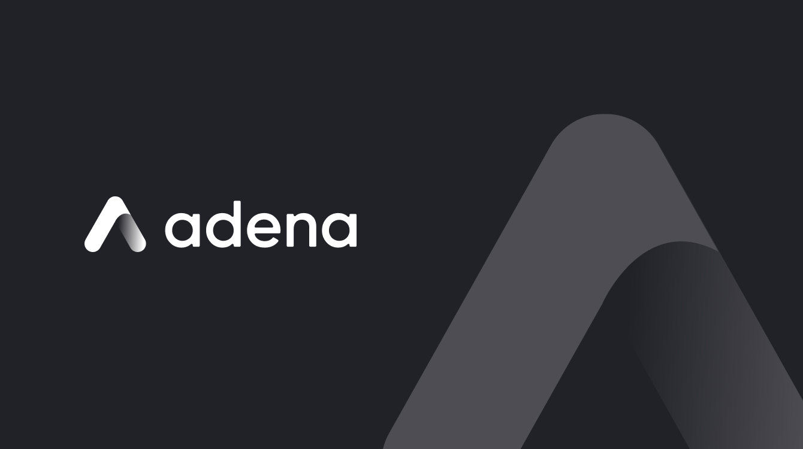

# Adena Wallet

[](https://twitter.com/adenaapp)

​

## Introduction

**Adena** is a friendly, open-source, non-custodial Gno.land wallet, built for Gnomes worldwide. Adena exists to power millions of realms (smart contracts in gnolang) and tokens that will flourish the Gno.land ecosystem with a quality interface, NFT & custom token support, and a seamless integration procedure.
​

For users, Adena makes managing crypto as simple as keeping and sending money on Paypal or Venmo.

​
For developers, Adena provides streamlined web3 experience upon integration!

​
You can find the latest official version of Adena on our [official website](https://adena.app/), or directly on [the Chrome Webstore](https://chrome.google.com/webstore/detail/adena/oefglhbffgfkcpboeackfgdagmlnihnh).

​
Also, follow us on our [Twitter](https://twitter.com/adenaapp) and [Medium](https://medium.com/@adena.app) for newest updates, patch notes, and partnership announcements!
​

## Features

✅ Create & Restore Wallet <br>
✅ View Account Balances <br>
✅ Deposit & Send Tokens <br>
✅ Transaction History <br>
✅ Settings <br>
✅ Connect to Dapps <br>
✅ Sign Gno Realms (smart contracts) <br>
✅ Explore Dapps <br>
✅ Multi-Accounts <br>
✅ Multi-Network <br>
✅ Multi-Mnemonic <br>
✅ Ledger Support <br>
✅ Web3 Login Support <br>
✅ Manage Custom Tokens <br>
✅ Airgap Account Support <br>
✅ View & Transfer NFTs <br>
⬜ In-app Swap <br>
⬜ Multi-Chain
​

## Project Environment

| Tool       | Version                                                          |
| ---------- | ---------------------------------------------------------------- |
| Node.js    | 26 (`.nvmrc`)                                                    |
| pnpm       | 11 (`packageManager` in `package.json`)                          |
| TypeScript | 7 for type checks; 6 for tools that need the compiler API       |
| Vite       | 8, with `@crxjs/vite-plugin` for the extension                   |
| React      | 19                                                               |
| Vitest     | 5                                                                |

## Local Setup

1. Use the Node.js version from `.nvmrc`:

   ```
   nvm install
   nvm use
   ```

2. Install pnpm. Node.js 26 no longer ships Corepack, so either install pnpm
   (`npm install -g pnpm`) or install and enable Corepack
   (`npm install -g corepack && corepack enable`). Either way the version pinned in
   `package.json` is the one that runs.

3. Install the dependencies. Dependency install scripts are off unless listed under
   `allowBuilds` in `pnpm-workspace.yaml`, and packages published less than 7 days
   ago are not installed (`minimumReleaseAge`).

   ```
   pnpm install
   ```

4. Social login reads its Web3Auth settings at build time. Copy
   `packages/adena-extension/.env.example` to `packages/adena-extension/.env` and fill
   it in; environment variables take precedence over the file. Without them social
   login is unavailable, the rest of the wallet works.

## Development Build

```
pnpm develop            # Chrome  -> packages/adena-extension/dist
pnpm develop:firefox    # Firefox -> packages/adena-extension/dist-firefox
```

This builds `adena-module` once, then watches it and the extension. Development
builds use React's development runtime, are not minified and include source maps.
They do not type-check; run `pnpm typecheck` for that.

Load the output as an unpacked extension (Chrome: `chrome://extensions` → Developer
mode → Load unpacked → `packages/adena-extension/dist`; Firefox: see
[FIREFOX.md](packages/adena-extension/FIREFOX.md)) and reload it after a rebuild.

### Hot reload (Chrome only)

```
pnpm develop:hmr        # Chrome  -> packages/adena-extension/dist, dev server on :5173
```

Runs the Vite dev server through `@crxjs/vite-plugin` instead of rebuilding. Load
`packages/adena-extension/dist` once; the extension then loads its code from the dev
server, which must keep running.

| Change in                         | Takes effect                                     |
| --------------------------------- | ------------------------------------------------ |
| Popup, register and security UI   | Hot update, state kept                           |
| `src/background.ts` and its imports | The extension reloads itself                   |
| `src/content.ts` and its imports  | Hot update in open pages                         |
| `src/inject.ts` and its imports   | Rebuilt into `dist/inject.js`; reload the page   |
| `adena-module`                    | Rebuilt by its watcher, then as above            |

The dev build widens the manifest's CSP to `http://localhost:5173` and
`ws://localhost:5173`; production builds keep it unchanged. Firefox is not supported
in this mode: use `pnpm develop:firefox`.

## Production Build

```
pnpm build              # Chrome  -> packages/adena-extension/dist
pnpm build:firefox      # Firefox -> packages/adena-extension/dist-firefox
```

Both type-check with TypeScript 7 first, then build minified bundles without source
maps. To check that every entry of a build still loads (service worker, pages,
content and inject scripts):

```
pnpm --filter adena-extension smoke dist            # or dist-firefox
```

## Checks

```
pnpm typecheck
pnpm test
pnpm lint
```

## Documentation

Check out our official documentation page for guides and brand assets.

- ️[User Guide](https://docs.adena.app/user-guide)
- [Developer Guide](https://docs.adena.app/integrations/)
- [Resources](https://docs.adena.app/resources/)
  ​
  ​

## Author

**Onbloc**

- [Website](https://onbloc.xyz)
- [Twitter](https://twitter.com/onblocxyz)
- [Medium](https://medium.com/onbloc)
  ​
  ​

## Contribution & Support

We welcome contributions from the community and are always eager to hear your ideas and feedback! If you have suggestions for improvement, want to contribute to Adena, or need support, please consider the following options:

- Read our contributing guidelines: Our [CONTRIBUTING.md](https://github.com/onbloc/adena-wallet/blob/main/CONTRIBUTING.md) file provides information on how to contribute to the project, including submitting pull requests, reporting issues, and suggesting improvements.
- Open an issue: If you encounter a bug, have a feature request, or want to suggest improvements, feel free to open an [issue](https://github.com/onbloc/adena-wallet/issues) on our GitHub repository.
- Join our community: For discussions, questions, or support, join our [channel](https://discord.com/invite/6eTSyZ3569) on Gno.land's Discord server. We're excited to collaborate and help!
